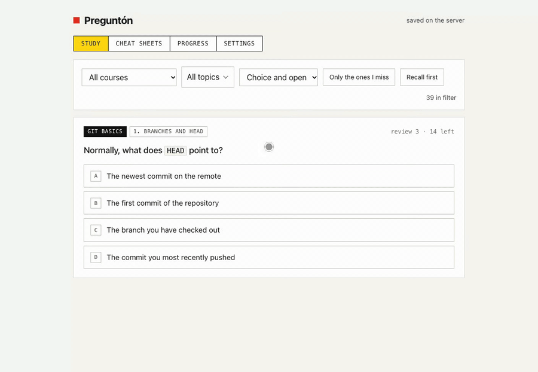
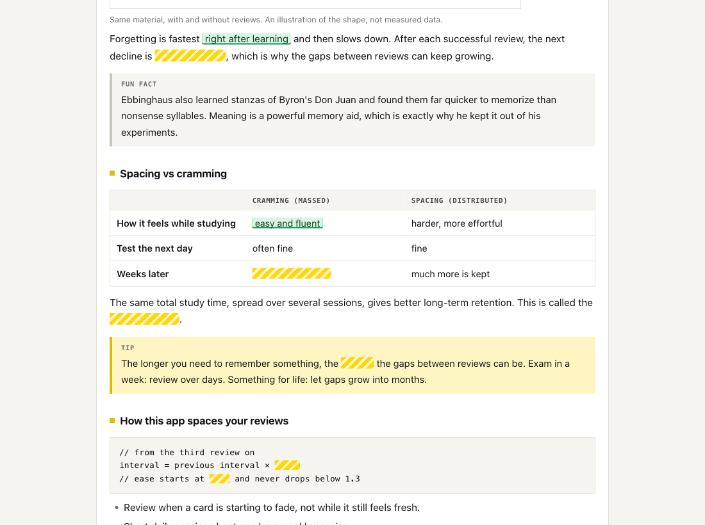
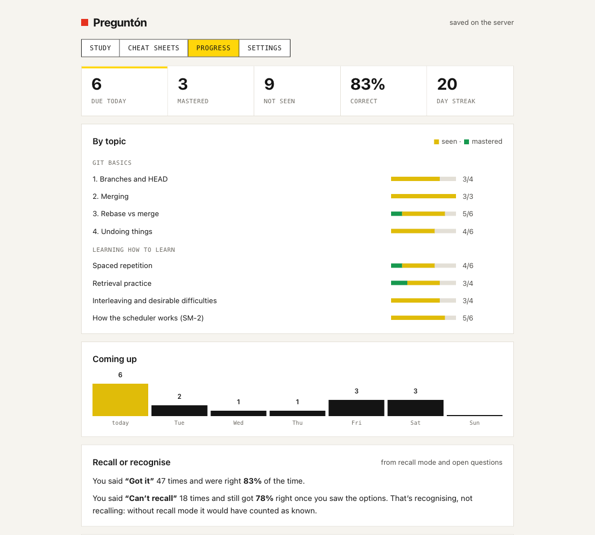
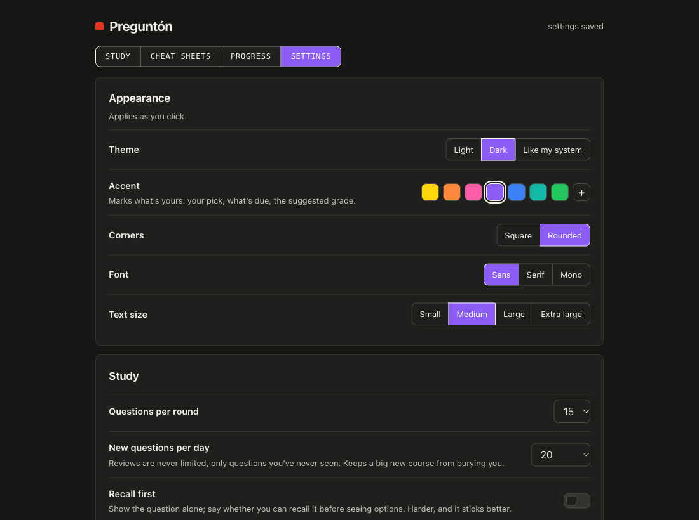
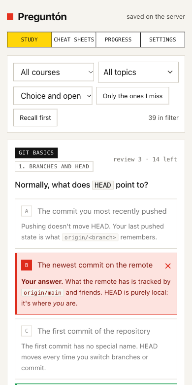

# Preguntón

A small spaced-repetition quiz app that you set up and shape with Claude Code. You tell Claude what you want to learn, it writes the course, and you study it in the browser. Every option explains why it's right or wrong, and the scheduler (SM-2) brings each question back just before you'd forget it.

It's plain Node with no dependencies: no `npm install`, no build step, no account. Your courses and progress are JSON files in a folder you choose, for example next to your notes.



## Get started

You need [Node.js](https://nodejs.org) 18 or later and [Claude Code](https://claude.com/claude-code). Open Claude Code in the folder where you keep your projects and paste:

```
Clone https://github.com/DanielFelipeGomez/pregunton into ./pregunton and follow its SETUP.md
```

Claude asks you four things (where to keep your data, how you want to start it, what your first course is about, and whether you want a reminder), sets everything up and opens the app. It takes a few minutes.

Prefer doing it by hand? Clone the repo, run `node server.js` and open http://localhost:4700. The tour course is there to try.

## What's in it

- **Multiple choice that teaches.** Options are shuffled every time, and each one says why it's right or wrong.
- **Recall first.** Hide the options until you say whether you can recall the answer. It's harder, and it shows how much you actually knew versus recognised.
- **Open questions.** Answer in your own words and check yourself against a rubric, or let a local model grade it (optional, through Ollama).
- **Cheat sheets.** A summary of a topic with the key facts hidden. You reveal them one by one, and each one comes back on its own schedule.
- **Images, diagrams and voices.** Questions can show an image or a Mermaid diagram, and read words aloud with your browser's voices, which helps with languages.
- **Progress.** What's due this week, which topics you've mastered, and the questions you keep missing, each with a prompt to work through it with Claude.

The tour course, *Learning how to learn*, uses all of these to explain the ideas behind the app: spacing, retrieval practice, interleaving and how the scheduler works.

A cheat sheet, with some facts revealed (green if you knew them, red if not) and the rest still hidden:



The Progress tab:



## Making it yours

Ask Claude for what you want, from Claude Code opened in the repo folder:

- "Make me a course about Kubernetes networking, about 20 questions, with a cheat sheet for services."
- "Turn my notes in ~/notes/aws into a course."
- "Read the repo at ~/code/billing and make a course for a new teammate."
- "Add a timer to each question."

The repo has a `CLAUDE.md` that explains how the app is built, so Claude can change it without breaking things, and a `new-course` skill with the rules for writing good questions. **Settings → Ask Claude** has more prompts to copy.

Settings also has the theme, accent colour, corners, font and text size, which features are on, how many new questions you get a day, and which courses to show.



## On your phone

Turn on **Settings → Study from your phone**, restart the server, and open the address it prints on a phone on the same Wi-Fi. There's no password, so anyone on that network can open it too.

<p align="center"></p>

## Your data

The data folder you chose holds `courses/`, `sheets/`, `media/`, `progress.json` and `settings.json`. Its path is in `local.json`, which isn't committed. Updating or deleting the repo doesn't touch it, unless you left it at the default `./data` inside the repo.

Progress is copied to `backups/` in that folder once a day (the last 14 days are kept) and before you reset a course. If `progress.json` gets damaged, the app stops and tells you instead of writing over it.

## Files

| Where | What |
|---|---|
| `server.js` | The server. Reads courses, saves progress and settings. |
| `public/` | The app: `study.js`, `sheets.js`, `settings.js`, shared code in `core.js`. |
| `lib/` | Config and data folder, validation, the optional Ollama grader. |
| `check.js` | Checks every course: `node check.js` |
| `due.js` | Prints what's due today, for a reminder in Claude Code or your shell. |
| `start.command` | Double-click to start it and open the browser (macOS). |
| `examples/tour/` | The tour course. |
| `extras/` | A launchd file to start it at login on macOS. |
| `docs/` | The screenshots in this README. |
| `SETUP.md` | What Claude follows to set you up. |
| `CLAUDE.md` | How the app works, for Claude. |

## License

[MIT](LICENSE).
